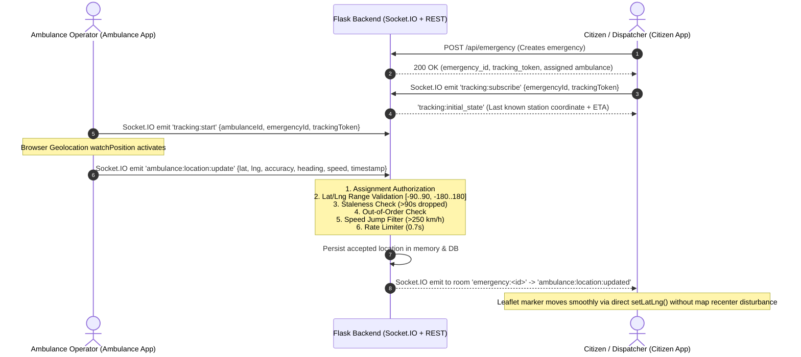

# Real-Time GPS Tracking Setup & Architecture Guide

## 1. Architecture Overview

This document outlines the genuine real-time GPS tracking implementation across the Smart Ambulance Route Optimization & Hospital Readiness System.



---

## 2. Event Contract & Data Schemas

### Client to Server Events

| Event Name | Direction | Payload Structure | Description |
| :--- | :--- | :--- | :--- |
| `tracking:subscribe` | Citizen / Driver -> Backend | `{ emergencyId: string, trackingToken: string }` | Joins authorized emergency room (`emergency:<id>`) and receives initial snapshot. |
| `tracking:start` | Driver -> Backend | `{ ambulanceId: string, emergencyId: string, trackingToken?: string }` | Signals operator activation of live GPS streaming. |
| `ambulance:location:update` | Driver -> Backend | GPS reading payload (see below) | Streams live location & telemetry fix. |
| `tracking:stop` | Driver -> Backend | `{ ambulanceId: string, emergencyId: string, reason?: string }` | Driver pauses GPS sharing or leaves session. |
| `driver_status_update` | Driver -> Backend | `{ ambulanceId: string, emergencyId: string, status: string }` | Updates mission phase (`en_route_to_patient`, `picked_up`, `en_route_to_hospital`, `arrived_at_hospital`). |

### Location Update Payload Schema (`ambulance:location:update`)

```json
{
  "ambulanceId": "b2d0b054-8d8a-42d6-b4fc-aecfb77f36d0",
  "emergencyId": "5ec9a555-da4d-45d0-9978-cf82572cde6b",
  "trackingToken": "8fN_aB3c9...",
  "latitude": 12.87321,
  "longitude": 74.84512,
  "accuracy": 6.5,
  "heading": 182.0,
  "speed": 11.2,
  "timestamp": "2026-10-25T07:15:00.000Z"
}
```

*Notes on Payload:*
- `latitude` must fall within `[-90.0, 90.0]`.
- `longitude` must fall within `[-180.0, 180.0]`.
- `accuracy` is in meters (optional/nullable).
- `heading` is in degrees from True North [0..360] (optional/nullable).
- `speed` is in meters per second (optional/nullable).
- `timestamp` is ISO-8601 string or numeric millisecond/second epoch.

### Server to Client Events

| Event Name | Direction | Payload Structure | Description |
| :--- | :--- | :--- | :--- |
| `tracking:initial_state` | Backend -> Citizen | Full snapshot `{emergencyId, ambulanceId, location, eta, distanceKm, trackingStatus, timestamp, phase}` | Emitted immediately upon joining room to avoid blank map state. |
| `ambulance:location:updated` | Backend -> Room | `{ambulanceId, emergencyId, latitude, longitude, location, accuracy, heading, speed, status, phase, eta, distance_km, timestamp}` | Real-time validated position dispatched to `emergency:<emergencyId>`. |
| `tracking:started` | Backend -> Room | `{emergencyId, ambulanceId, status: "live", timestamp}` | Notifies subscribers that GPS acquisition is active. |
| `tracking:stopped` | Backend -> Room | `{emergencyId, ambulanceId, reason, timestamp}` | Broadcast when trip ends, unit is paused, or ambulance declined. |
| `tracking:error` | Backend -> Client | `{code: string, message: string}` | Sent to offending socket on validation failure or unauthorized request. |
| `ambulance_rerouted` | Backend -> Room | `{emergencyId, originalAmbulanceId, nextAmbulance, nextAmbulanceId, reason}` | Notifies citizen when initial ambulance declines and replacement unit is assigned. |

---

## 3. Security, Authorization & Validation Rules

1. **Token & Assignment Scope**:
   - Every emergency creation creates a 24-character cryptographic token (`tracking_token = secrets.token_urlsafe(24)`).
   - Only sockets providing the matching `trackingToken` or assigned driver identity can access `emergency:<id>` rooms.
   - Sockets attempting to publish updates for an ambulance not assigned to that emergency receive `UNAUTHORIZED_AMBULANCE` (`403`).
2. **Coordinate Sanity**:
   - Latitude and longitude types are cast to float; values outside `[-90, 90]` or `[-180, 180]` are dropped with `INVALID_COORDINATES`.
3. **Staleness & Out-of-Order Dropping**:
   - Readings older than 90 seconds relative to server time are rejected with `STALE_READING`.
   - GPS readings with timestamps earlier than the latest accepted reading (`parsed_ts < prev_ts - 0.5s`) are dropped with `OUT_OF_ORDER`.
4. **Teleportation / Speed Jump Filter**:
   - Consecutive readings are compared against Great-Circle distance and elapsed time. Implied speeds exceeding **250 km/h** with jump distance > 1 km are rejected with `IMPOSSIBLE_JUMP`.
   - The jump filter is only activated after the initial device fix is accepted, ensuring initial station dispatch coordinates do not cause false positives.
5. **Rate Limiting**:
   - Ingestion enforces a throttle window of **0.7 seconds** per ambulance unit (`RATE_LIMITED`), preventing socket flooding from noisy devices.

---

## 4. Frontend Hook (`useLocationTracking`)

A unified React hook `useLocationTracking.js` handles client-side device GPS acquisition across both web and mobile environments:
- **Location API**: Employs `navigator.geolocation.watchPosition()` with `enableHighAccuracy: true`, `maximumAge: 0`, and `timeout: 10000`.
- **Distance Filter**: Implements Great-Circle deadband filtering (ignores micro-jitter `< 3 meters` when stationary).
- **Throttling**: Caps socket transmissions to an optimal 2.0s interval.
- **Reconnection Resiliency**: Re-emits `tracking:start` and updates room subscriptions upon Socket.IO reconnection events without requiring page reload.
- **Cleanup**: Calls `navigator.geolocation.clearWatch(watchId)` when tracking is paused, stopped, or component unmounts.

---

## 5. Environment Variables & Deployment Configuration

### Backend (`aro-backend-tvkq.onrender.com`)
```env
PORT=5000
FRONTEND_URL=https://aro-citizen.onrender.com,https://aro-ambulance.onrender.com
ALLOWED_ORIGINS=https://aro-citizen.onrender.com,https://aro-ambulance.onrender.com,http://localhost:3000,http://localhost:5173
```
- **Render Start Command**:
  ```bash
  gunicorn -k geventwebsocket.gunicorn.workers.GeventWebSocketWorker -w 1 app:app
  ```

### Citizen App
```env
REACT_APP_API_URL=https://aro-backend-tvkq.onrender.com
```

### Ambulance App
```env
VITE_API_BASE_URL=https://aro-backend-tvkq.onrender.com
```

---

## 6. Local & Remote Testing Guide

### Automated Backend Tests
Run the standalone real-time tracking test suite:
```bash
cd backend
python test_realtime_tracking.py
```
*Expected Output:*
```
Ran 7 tests in 4.279s
OK
```

The test suite covers:
- Boundary latitude/longitude checks
- Impostor ambulance spoof rejection
- Out-of-order reading and stale reading rejection
- Impossible speed jump rejection (>250 km/h)
- Room isolation and initial snapshot delivery
- Declination and dynamic rerouting lifecycle
- Telemetry normalization and persistence

### Manual Local Verification (Two Browser Windows)
1. **Start Backend**:
   ```bash
   cd backend
   python app.py
   ```
2. **Start Citizen App** (Port 3000):
   ```bash
   npm start
   ```
3. **Start Ambulance App** (Port 5173):
   ```bash
   cd ambulance-app
   npm run dev
   ```
4. **Trigger Flow**:
   - Open Citizen App (`http://localhost:3000`), select emergency type (e.g. "Heart Attack") and click **Dispatch Ambulance**.
   - Note the assigned ambulance name and `emergency_id`.
   - Open Ambulance App (`http://localhost:5173`), select the matching unit and click **Accept Emergency**.
   - Click **Start Real-Time GPS Tracking** (allow browser location prompt).
   - Observe live GPS accuracy, speed, heading, and dynamic route recalculation in Citizen App.
   - Pan the map in Citizen App: verify that the user's manual pan/zoom position is preserved without rubber-banding unless "Follow Unit" is toggled.
   - Click **Pause GPS Sharing** in Ambulance App: observe that Citizen App shows `GPS signal stale (>15s)` notice.

### Browser Permissions on HTTPS Deployments
- **HTTPS Requirement**: The Geolocation API (`navigator.geolocation.watchPosition`) requires a Secure Context (`https://` or `localhost`). It is blocked by modern browsers on insecure `http://` remote domains.
- **Permission States**:
  - `Permission Denied`: Displays clear guidance banner prompting user to enable Location Services in site settings.
  - `Position Unavailable`: Occurs indoors or when hardware GPS has no satellite lock; falls back cleanly without crashing the UI.
  - `Timeout`: Hook retries automatically with fallback high-accuracy configurations.

---

## 7. Troubleshooting & Diagnostics

| Symptom | Cause | Solution |
| :--- | :--- | :--- |
| `Cross-Origin Request Blocked (CORS)` | Origin not in backend allowed origins | Verify `ALLOWED_ORIGINS` or `FRONTEND_URL` in backend env matches frontend deployment domain. |
| Marker does not move in Citizen view | Citizen client not subscribed to room | Verify citizen emitted `tracking:subscribe` with matching `emergencyId` and `trackingToken`. |
| Coordinates rejected with `IMPOSSIBLE_JUMP` | First GPS reading checked against old station coordinate | Ensure `device_timestamp` is initialized on first accepted fix; speed jump only computed between consecutive fixes. |
| Location updates fail with `UNAUTHORIZED_AMBULANCE` | Operator sent an ID differing from assigned fleet unit | Verify `ambulance_id` matches `ACTIVE_EMERGENCIES[id]['ambulance_id']`. |
| Map resets zoom level on every update | Map re-rendered unconditionally on coordinate change | Use direct Leaflet `marker.setLatLng([lat, lng])` and toggleable `autoFollow` state. |
